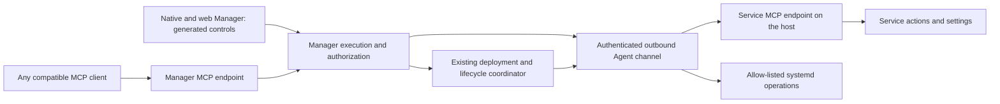

# MCP tools, generated controls and service settings

Design proposal, 20 October 2026. Requirements from the user: services describe actions/settings
once; Server Manager displays real buttons/forms; the same capabilities can be used by MCP clients,
including ChatGPT and the company's Copilot. The implementation must be independent of an AI vendor.
This document records the design. A [standalone SDK prototype](README.md) now implements a fixed
service tool registry, standard in-memory discovery/invocation and a read-only demo. The production
HTTP endpoints, Agent relay, authorization integration and generated controls are not implemented yet.

## Completed first slice

`Dev/MCPTooling` is a separate development package, pinned to official Swift SDK 0.12.1. It leaves
existing Core products and deployed services unchanged. A service registers an SDK definition and
handler together; discovery and calls use the same registry. Seven SDK integration tests and the
executable demo cover metadata/schema preservation, structured results, duplicate names, unknown
tools, handler validation, domain failures and pagination. This is not a JSON Schema validator or
an authorized network endpoint. See the package README for the runnable example and limits.

## Architecture



The service owns its business behavior and advertises standard MCP tools. The Agent is an MCP client
for host-configured local services. The Manager maintains the routed catalog, executes policy/audit
and is an MCP server for external clients. Native/web clients use the same catalog/execution layer.
They may access it through the existing Manager HTTP API; every UI does not have to implement a
separate MCP network stack.

Terminate MCP at each boundary. Relay typed catalog/invocation/result messages through the Agent
channel, preserving schema data and stable routing IDs. Only the required tools operations are
supported initially; do not tunnel arbitrary JSON-RPC requests through an authenticated host channel.
Transport/protocol compatibility stays in the adapters around the common execution model.

The MCP specification provides discovery, input/output schemas and display metadata and explicitly
allows different interaction patterns. Rendering those schemas as forms is our Manager feature.
See [MCP tools](https://modelcontextprotocol.io/specification/2026-07-28/server/tools).

## Official Swift SDK

Use the [official MCP Swift SDK](https://github.com/modelcontextprotocol/swift-sdk), as requested.
Use its `MCP` product for service servers, the Agent client and the Manager server. Keep protocol
messages, negotiation and HTTP transport handling in the SDK; our code supplies business handlers,
routing, policy and the generated controls.

The reviewed release is [0.12.1](https://github.com/modelcontextprotocol/swift-sdk/releases/tag/0.12.1).
Start with an exact version and commit each consuming package's resolved dependency graph. Its
manifest requires Swift 6.1 (the README's Swift 6.0 statement is older); our Linux 6.3 build meets
that requirement. Verify resolution and runtime compatibility with the existing Vapor/NIO pins on
Linux and with the supported native app toolchain before adding it to release builds. The SDK
advertises the 2025-11-25 protocol; the newer specification links here do not imply that this release
implements every newer feature. Negotiate supported versions and test the clients we intend to use.

Use `Client` and `HTTPClientTransport` for the Agent's fixed, host-configured service endpoints.
Use `Server`, `Tool`, `ListTools` and `CallTool` for tool registration/discovery/execution. For the
existing Vapor hosts, add a thin request/response adapter to the SDK's HTTP server transports,
including streaming and session routing where needed. The SDK transport accepts framework-neutral
requests; it does not install a Vapor route or manage our user permissions automatically. Reuse that
adapter across services and Manager. Use the SDK's in-memory transport for focused contract tests.

The SDK's authorization support supplies protocol integration points; it does not turn our current
password-login service into an OAuth authorization server. Retain the delegated-authentication
milestone below. Schema-derived controls and authoritative business validation remain Funico work.

## Define a tool once

An illustrative Invoices definition:

```json
{
  "name": "set_process_interval",
  "title": "Change process interval",
  "description": "Change how frequently invoice processing is scheduled, in minutes.",
  "inputSchema": {
    "type": "object",
    "properties": {
      "minutes": {
        "type": "number",
        "title": "Interval in minutes",
        "minimum": 0.1,
        "maximum": 720
      }
    },
    "required": ["minutes"],
    "additionalProperties": false
  },
  "annotations": {
    "readOnlyHint": false,
    "idempotentHint": true
  }
}
```

This is a proposed tool, not an endpoint available in today's service. Its range comes from the
existing `Configuration.setProcessInterval` code. Idempotence requires an implementation that
recognizes an already-applied value and avoids additional side effects.

The native/web renderer implements a reusable supported schema profile: no inputs → button;
enum → selector; number → bounded numeric field; boolean → switch; string → text field; objects →
grouped fields. Required/optional fields and validation errors come from the definition. More complex
schemas need a supported generic editor or an explicit unsupported-schema message; silently
dropping constraints is unacceptable. Server-side schema validation remains authoritative.

Tool results use structured output for state, configured/effective values and operation IDs. A generic
result view displays them. Optional company UI metadata can add grouping, order or units; it must be
optional so a regular MCP client remains usable without a Funico-specific extension. Rich screens
can be added later, but ordinary new tools need no per-tool native/web view or Manager handler.

Keep parameter constraints in the service's shared model and derive schema/runtime validation from
that definition where possible. The initial authoring API should not require manually duplicating
the same numeric bounds or enum vocabulary in every client and in the service handler.

### Existing HTTP APIs

An optional, reusable OpenAPI-to-MCP adapter can wrap explicitly selected operations of an existing
service. That is an implementation option for our platform, not automatic behavior supplied by MCP.
Invoices already has OpenAPI operations/handlers for the scheduler controls, so such an adapter
could reuse them instead of maintaining a second business implementation. Missing settings operations
still need actual service behavior first.

Map only opted-in operation IDs to tools, with fixed service-local targets and deliberate metadata/
policy. Do not expose every operation of an arbitrary OpenAPI document, or accept a server URL from
an invocation. A service implementing MCP natively and a service using the adapter should be
indistinguishable to the Manager catalog and generic renderer.

## One implementation, several entry points

| User goal | Owning implementation | Generated control / MCP exposure |
|---|---|---|
| Execute the Mailing job | Invoices scheduler action | Service tool `execute_job`, with a job enum |
| Start/stop/pause/resume a job | Invoices scheduler action | Explicit service tools; separate from process lifecycle |
| Change process interval to 1 minute | Invoices validated settings operation | Numeric form / `set_process_interval(minutes: 1)` |
| Update Invoices | Existing Manager deployment coordinator | Manager-owned release discovery/deployment tools |
| Restart a Scheduler service | Existing Agent systemd backend | Manager-owned lifecycle tool, scoped to a service |

Infrastructure tools belong to the Manager/Agent. A service does not gain authority to install its
own binary or operate arbitrary systemd units merely by exposing an MCP tool. Existing rich release
and deployment screens may remain, using the same underlying coordinator as the tool handler.

Names and target routing must distinguish multiple hosts/services reliably. Use stable inventory IDs
and a reversible, collision-checked namespace for exported tools, with service/host titles as display
metadata. Do not infer a target solely from an ambiguous display name. The UI supplies the selected
inventory context; external clients resolve it from discovery. No caller supplies a URL, executable,
unit name or filesystem path.

## Shared execution and trust boundary

- Host-owned configuration registers the local MCP endpoint and permitted capability/policy set.
  New advertised tools can produce new forms after discovery; new authority is governed by policy.
  This requires configuration/approval where appropriate, not new UI code for every tool.
- Authenticate the Agent to each local service with a narrowly scoped service credential, stored
  with restricted filesystem permissions and redacted from logs. Loopback binding alone does not
  restrict other users/processes on the host. Configure this through the reusable hosting adapter;
  do not forward a person's external access token to the service or treat caller-supplied actor
  arguments as proof of identity.
- Tool discovery is data. A tool's title, description, schema or annotations cannot grant a role or
  widen the Agent's host permissions. Unapproved/changed capabilities and unsupported schemas fail
  closed. Never forward arbitrary MCP methods, shell commands or URL targets from clients.
- The Manager authorizes each invocation against the authenticated person, target and tool policy;
  discovery is filtered appropriately but call-time checks remain mandatory. Native/web and MCP
  requests pass through the same validation, audit and execution path. No shared administrator
  identity stands in for every external user.
- Reuse command IDs, journal replay suppression, deadlines and per-service serialization. Preserve
  an interrupted operation as uncertain/failed rather than automatically executing a Mailing job
  twice. An accepted job execution and completed business work are distinct outcomes.
- Record the authenticated actor, originating client, host/service, tool/schema version, redacted
  arguments, command/operation ID and outcome. Credentials and secret setting values stay out of
  schemas, results and audit text.
- Snapshot/version the catalog and schema used by each invocation. Refresh after service upgrades
  and catalog-change notifications; preserve or explicitly retire public tool contracts. Check the
  actual protocol versions/features supported by each target client during integration.

## Settings are service behavior

Invoices currently stores `.Configuration.json` on SMB. Its CLI writes that file and explicitly asks
for a service restart; schedules are constructed when scheduler jobs are initialized. Therefore
`set_process_interval` needs a real service implementation: validate, persist, and either safely
reschedule the job or report that a restart is pending. Return configured and effective values so
neither the UI nor an AI client claims the running schedule changed when only a file changed.

Use the service's domain settings API; the Manager does not edit arbitrary configuration files.
Handle concurrent changes with a revision/precondition and preserve unrelated fields. The existing
SMB `getConfiguration()` writes defaults when loading/decoding fails; do not reuse that as a tool
advertised as read-only. Add a strict read path with clear errors for missing/invalid configuration.

## Authentication and connectivity

Use the standard MCP HTTP authorization contract and a configurable authorization provider, keeping
client-vendor integrations outside the service/catalog model. The current Funico Authentication
source offers password login/refresh, role grants and JWKS; it does not yet provide the OAuth
authorization-code/discovery flows needed for a standard authenticated remote MCP connection.
An OAuth-capable provider/bridge or reviewed extension is a separate implementation milestone.
See [MCP authorization](https://modelcontextprotocol.io/specification/2026-07-28/basic/authorization).

The current Mac-to-server SSH forward validates the Manager console. External AI clients need an
appropriate supported network path to the Manager MCP endpoint. Evaluate private connectors or
HTTPS ingress against the actual company's client and policy; no new inbound port is opened by
this design. Host agents continue to connect outbound; service MCP endpoints stay local to their
host. Each vendor's optional tunnel/plugin packaging can be configured later without changing the
standard tool definitions or business handlers.

## Implementation sequence

1. Finish the independent management installation with an empty Agent allow-list. Keep Invoices
   on its existing process while these features are developed.
2. Integrate the pinned official Swift SDK and reusable Vapor HTTP adapter. Establish the supported
   MCP versions/schema profile and execution contracts in the shared model.
   Add a reusable service registration layer; wrap existing Invoices job behavior, preserving its
   current HTTP clients during transition. Introduce settings operations with explicit apply semantics.
3. Add host-configured MCP discovery/invocation to the Agent and typed relay messages to the existing
   authenticated channel. Add the Manager catalog, policy, schema validation and common audited path.
4. Build generic native and web forms/results once. Verify a newly added fixture tool appears and
   works without adding a Manager route or tool-specific UI component.
5. Expose the approved catalog plus Manager lifecycle/deployment tools at a standard MCP endpoint.
   Complete standards-based delegated authentication and test with two independent MCP clients.
6. Rehearse all four requested user goals with disposable services/queues. Verify permissions,
   schema changes, state conflicts, duplicate delivery, disconnects and settings persistence/apply
   behavior. Arrange the real Invoices migration once its operational controls, release and recovery
   gates pass. External AI-client connectivity can follow independently; it does not block the
   initial management installation or require opening the service MCP endpoints to the network.

The user-facing outcome is **implement/register the service tool once, receive standard Manager
controls and MCP exposure from the shared infrastructure**. Business behavior, settings persistence,
authorization policy and the generic infrastructure still require implementation.
